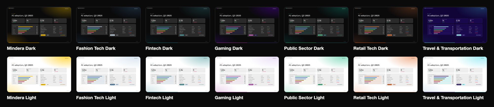
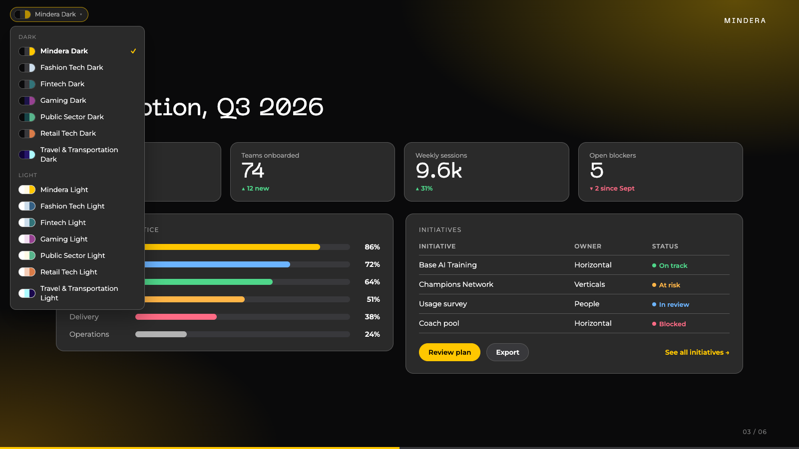
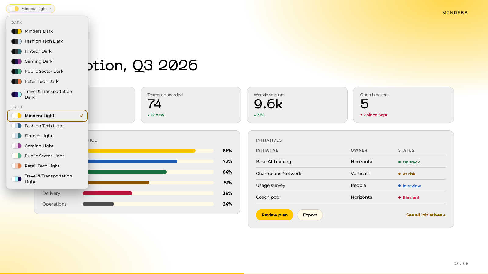

# Mindera themes

A small library that gives any web page Mindera's brand themes, one per official Google Slides template:

- **`mindera-theme.css`**: colour tokens for fourteen themes, the brand fonts, glow helpers and the picker's styles.
- **`mindera-theme.js`**: a classic script for `<head>`. It applies the saved theme before the first paint, builds the theme picker, and exposes a small API.

The page's own CSS uses the `--mt-*` tokens, either directly or through an adapter that maps the page's existing variables onto them. Switching theme only changes the tokens, so no other CSS has to know which theme is active.

## What it looks like



The theme picker, open on Mindera Dark and Mindera Light:




More in `screenshots/`: the title and tokens slides in every theme, and a slide that shows all fourteen palettes side by side.

## Files

| Path | What it is |
|---|---|
| `assets/mindera-theme.css` | Tokens, fonts, `.mt-glow` / `.mt-glow-fixed`, picker styles. Copy it. |
| `assets/mindera-theme.js` | Pre-paint, picker and API. Copy it. |
| `assets/fonts/` | PP Neue Machina + Montserrat. Copy it next to the CSS (the CSS loads `fonts/…` relative to itself). |
| `assets/mindera-base.css` | Optional element defaults (body, headings, links, buttons, inputs, tables). Only for pages with no styles of their own. |
| `scripts/check_themes.js` | Renders a page in every theme, checks contrast, saves screenshots. |
| `references/integrations.md` | Adapting existing CSS, bundled apps, Next.js, React, Tailwind, Bootstrap, charts/canvas, iframes, PDF export. |
| `references/palettes.md` | Where every colour comes from (the Slides templates' Guidelines slides and glows), the type scale, how the other tokens were derived, adding a palette. |
| `references/presentations-repo.md` | How the Presentations repo (decks + index) uses it. Read it when working there. |
| `screenshots/` | Example pages in each theme, used in "What it looks like". |

## Themes

There is one theme per official Google Slides template ("2025 Mindera … Slideshow Template Dark/Light"). Each brand has a `-dark` and a `-light` theme:

| Brand | Ids | Accent (fill) | Glow |
|---|---|---|---|
| Mindera (the General template) | `mindera-dark`, `mindera-light` | `#FFC700` yellow | amber / yellow |
| Fashion Tech | `fashion-tech-dark`, `fashion-tech-light` | `#CCDDEB` ice blue (dark), `#345F83` steel blue (light) | navy / ice |
| Fintech | `fintech-dark`, `fintech-light` | `#327379` teal | deep teal / mint |
| Gaming | `gaming-dark`, `gaming-light` | `#964191` plum, highlight `#D8AAD5` | violet / lavender |
| Public Sector | `public-sector-dark`, `public-sector-light` | `#58B48C` green | teal-green / mint |
| Retail Tech | `retail-tech-dark`, `retail-tech-light` | `#D97C49` copper | burnt orange / peach |
| Travel & Transportation | `travel-dark`, `travel-light` | `#ADFBFF` cyan (dark), `#1A084D` indigo (light) | blue / cyan |

The templates share one structure, and the themes follow it:
- Dark themes use a near-black page, `#2A2A2A` cards, white text and `#595959` lines. Travel Dark is the exception: its page is indigo (`#110437`).
- Light themes use a white page, `#EEEEEE` cards and black text.
- Each brand changes only its accent and its glow.

`references/palettes.md` has the details.

Before the Dark/Light split there were single-mode ids: `fintech` (light), and `fashion-tech`, `gaming`, `public-sector`, `retail-tech` and `travel` (dark). Those ids still work wherever an id is accepted (saved choices, `data-default`, `data-themes`, `set()`), and each maps to the theme it used to be. CSS selectors such as `[data-mindera-theme="fintech"]` no longer match, so update them to the new ids or to `[data-mindera-mode="light"]`.

**Fonts.** Headings use PP Neue Machina and body text uses Montserrat, as in the brandbook. The Slides templates use Montserrat for everything, because Google Slides can't load PP Neue Machina. When the output is Google Slides, a .pptx, a Google Doc or anything else that can't embed the font, use Montserrat for headings too. Headings then stand out by size, weight and capitals, as they do in the templates: titles in regular weight, small labels in capitals at weight 500–600. The template type scale is in `references/palettes.md`.

## Tokens

Every theme sets all of these on `<html data-mindera-theme="…">`. The script also sets `data-mindera-mode="dark"` or `"light"` there, so CSS that only cares about the mode can use `[data-mindera-mode="light"]` instead of listing theme ids.

| Token | Use |
|---|---|
| `--mt-bg`, `--mt-surface`, `--mt-surface2`, `--mt-border` | page, card, inset/tag, lines |
| `--mt-text`, `--mt-muted`, `--mt-muted2` | text from strongest to faintest (`muted2` only for incidental text) |
| `--mt-accent` | filled things: primary buttons, active tabs, progress bars |
| `--mt-on-accent` | text on `--mt-accent` |
| `--mt-accent-ink` | accent-coloured text, links, focus rings |
| `--mt-danger`, `--mt-success`, `--mt-warning`, `--mt-info` | status text and icons (4.5:1 on `--mt-surface`) |
| `--mt-glow-a`, `--mt-glow-b` | the brand glows |
| `--mt-chart-1` … `--mt-chart-6` | series colours for charts and categories |
| `--mt-font-head`, `--mt-font-body` | PP Neue Machina, Montserrat |

Use `--mt-accent` for anything filled and `--mt-accent-ink` for anything people read. The two differ wherever the brand colour can't be read as text. Mindera Light's yellow, Public Sector Light's green and Retail Tech Light's copper get a darker ink. Fintech Dark's teal, Gaming Dark's plum and Retail Tech Dark's copper get the template's paler highlight colour. Keeping this one rule is what makes all fourteen themes legible.

Everything is namespaced: `--mt-*` variables, `.mt-*` classes and the `data-mindera-theme` attribute. That's deliberate, so the library can't collide with an app's own `--bg`, `.theme-toggle` or another library's `data-theme` (e.g. DaisyUI).

## Adding it to a page or app

1. **Vendor the files.** Copy `mindera-theme.css`, `mindera-theme.js` and `fonts/` into one folder the page can serve: next to the HTML for a static page, `public/` for a bundled app. Copy `mindera-base.css` too if the page has no styles yet.

2. **Load them in `<head>`.** Load the script as a plain, synchronous script: not `defer`, not `type="module"`, not imported through a bundler. It has to run before the body paints, and it reads its options from its own tag.
   ```html
   <link rel="stylesheet" href="mindera-theme.css">
   <link rel="stylesheet" href="mindera-base.css">   <!-- optional -->
   <script src="mindera-theme.js" data-storage-key="my-app-theme"></script>
   ```
   Options (all optional):
   - `data-storage-key`: the localStorage key. Pages that share a key and an origin share the choice. Default `mindera-theme`.
   - `data-default`: a theme id; `auto` to follow the OS light/dark setting with Mindera until someone picks, or `<brand>-auto` (e.g. `fintech-auto`) to do the same with one industry. Default `mindera-dark`.
   - `data-themes`: a comma-separated subset, in order (e.g. `mindera-light,mindera-dark` for a plain light/dark switch).
   - `data-picker`: `auto` (slot if present, else floating; the default), `float`, `slot`, or `none`.
   - `data-position`: corner for the floating picker: `top-left` (default), `top-right`, `bottom-left`, `bottom-right`.

3. **Style with the tokens.**
   - **New page:** write CSS against `--mt-*` directly.
   - **Existing page:** add an adapter stylesheet after the page's CSS that maps its variables onto the tokens. Then hunt down hard-coded colours, and darken category colours on the light themes.

   `references/integrations.md` covers the adapter in detail, plus Tailwind, Bootstrap and frameworks.

4. **Place the picker.** By default it floats top-left. To put it in a header, add `<div data-mindera-theme-picker data-align="right"></div>`. In a framework app, set `data-picker="none"` and call `MinderaTheme.mountPicker(el)` from a component; integrations.md shows a React example.

5. **Add the glows.** Use `.mt-glow-fixed` on `<body>` for scrolling pages, and `.mt-glow` on full-screen elements like slides or hero sections.

6. **Redraw JS-drawn colours on change.** Canvas or chart libraries won't follow CSS variables. Read `MinderaTheme.token('chart-1')`, and redraw inside `MinderaTheme.onChange(...)`.

## JavaScript API

```js
MinderaTheme.themes                    // [{ id, name, group, brand, mode }] after data-themes filtering
MinderaTheme.get()                     // 'mindera-dark'
MinderaTheme.mode()                    // 'dark' or 'light'
MinderaTheme.set('fintech-light')      // apply and save; set(id, { persist: false }) applies only
MinderaTheme.token('accent')           // '#00757a' (also accepts '--mt-accent')
const off = MinderaTheme.onChange(id => …)   // also fires for changes made in other tabs
MinderaTheme.mountPicker(el, { align: 'right' })
document.addEventListener('mindera:themechange', e => e.detail.id)
```

## Checking

```bash
node <skill>/scripts/check_themes.js <page.html or http://localhost:5173/> --out <scratch-dir>
```

The checker switches the page through every theme it offers. It prints contrast ratios for each token pair and flags anything under 4.5:1 (3:1 for `muted2`) as LOW. It also screenshots each theme, and exits non-zero on LOW pairs or page errors. The shipped tokens all pass, so a LOW means the page is overriding a token somewhere.

The numbers only cover tokens, so **look at every screenshot**. Hard-coded colours, an invisible chart line on Fintech or white text on Mindera Light only show up there. Then try the picker in a browser:
- Arrow keys and Escape work.
- Keys pressed in the menu don't reach the page.
- The choice survives a reload.

## Changing or adding a theme

The skill's `assets/` hold the canonical copy. Projects vendor their own copies; search for `mindera-theme.js` to find them. Change the canonical copy, then copy it out to those projects. To add a palette from the brandbook, follow `references/palettes.md`.
